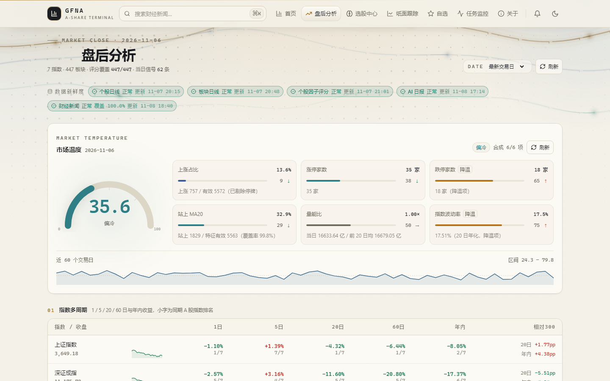
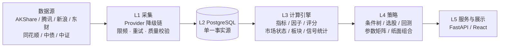
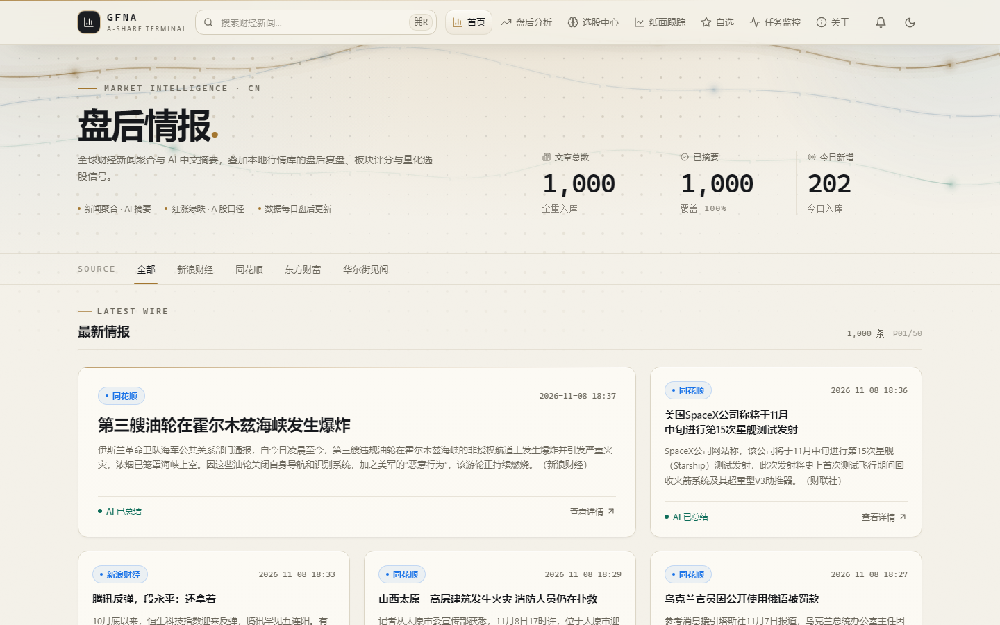
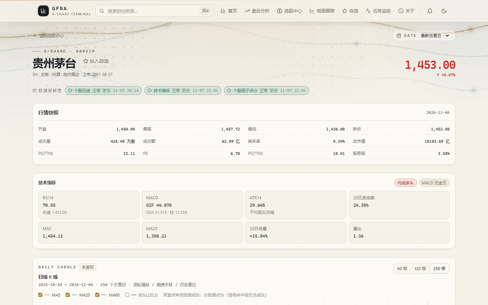

<div align="center">

# A-Share Quant Terminal

**A 股行情采集 · 因子评分 · 条件选股 · 回测与纸面跟踪**

把「数据 → 指标 → 信号 → 验证」做成一条可复现的本地闭环。

[](https://github.com/hui-Elna/a-share-quant-terminal/actions/workflows/ci.yml)
[](https://www.python.org/)
[](https://fastapi.tiangolo.com/)
[](https://www.postgresql.org/)
[](https://react.dev/)
[](LICENSE)

[快速开始](#快速开始) · [核心能力](#核心能力) · [架构](#架构) · [当前策略](#当前策略) · [界面一览](#界面一览) · [文档](#文档)

</div>

---



<p align="center"><sub>盘后分析：市场温度、指数多周期、板块热力图、两融与 AI 复盘</sub></p>

---

## 这是什么

一套面向个人研究的 **A 股量化终端**。它不预测涨跌，而是把投资决策所需的数据与信号整理成一套 **可复现、可归因、可证伪** 的系统：

- **数据本地化**：行情、估值、资金流、板块、指数、两融、国债收益率、新闻全部落到本地 PostgreSQL；
- **计算本地化**：指标、六维因子、市场温度、市场状态、板块评分都在本地库完成，接口请求不访问外部数据源；
- **结果可复现**：每次选股都带 `run_id`、参数快照与数据版本，改参数必然产生新 run；
- **验证闭环**：同一套成交规则支持回测、参数敏感性矩阵与纸面组合跟踪；
- **诚实表达**：缺失数据保留 `NULL`，不补 0；数据新鲜度由前端徽标显式标注。

> 回测 ≠ 实盘。系统价值在于让决策过程可追溯，而不是承诺收益。

---

## 核心能力

| 能力 | 说明 |
|---|---|
| **采集与治理** | Provider 降级链 `akshare → baostock`，腾讯/新浪/东财/同花顺/中债/中证专项通道；限频、重试、熔断、幂等 upsert、断点续传 |
| **单一事实源** | PostgreSQL 16；个股日线按年 RANGE 分区；板块成分用 SCD2 表达；财报/分红按公告日做 point-in-time |
| **指标与因子** | MA / RSI(Wilder) / MACD / BOLL / ATR / KDJ / 动量 / 波动 / 量比；价值、质量、动量、波动、流动性、情绪六维因子 |
| **条件选股** | AND/OR 条件树，支持比较、区间、集合、排名分位、行业约束；参数进入计算、缓存键与 run 快照 |
| **回测与验证** | T+1 开盘成交、佣金/印花税/滑点、涨跌停/停牌不可成交、后复权收益；参数矩阵与纸面组合复用同一引擎 |
| **市场与板块** | 市场温度计（7 子项）、五态市场状态与配置建议、板块三面评分、风格轮动、6 宽基牛熊估值 |
| **服务与展示** | FastAPI + React；统一错误码、数据新鲜度徽标、任务监控、CSV 导出、企业微信盘后推送 |

---

## 架构



**分层规则**

```
api/ ──────────────► strategy/ ──► engine/ ──► db/
 │                        │           │
 │                        └───────────┴──────► core/
 └──► pipeline.py ──► ingest/ ──► db/
```

- `ingest/` 只依赖 `core` + `db`，不 import `api` / `strategy`；
- `engine/` 不联网（板块资金流降级除外），不 import `ingest`；
- `strategy/` 只读数据库，不访问外部数据源；
- `api/` 只做参数校验、读库与响应组装，不做计算；
- 定时任务、手动 API、CLI 都走 `pipeline.run_task`，保证“命令行能跑的，接口也能跑”。

---

## 当前策略

统一前置过滤：剔除 ST、停牌/退市、上市不足 60 个交易日、当日无行情。

| 策略 | 状态 | 选股逻辑 | 排序 |
|---|---|---|---|
| **A3** 央企 × 综合评分 | 正式启用 | `ownership='央企'`，六因子综合分 ≥ `min_score`（默认 6.0/10） | 综合分降序 |
| **A4** 高股息质量 × 低估值 | 正式启用 | PE/PB 受控、股息率达标、20 日均额达标、`close ≥ MA120 × trend_dev`；仅在防御型市场阶段启用 | 股息率降序 |
| **C1–C6** 观察候选 | 可查看/执行/回测 | 海龟突破、高窄旗形、RPS 突破、涨停洗盘、均线放量、布林挤压 | 各自指标 |
| **B1–B5** 短线策略 | 已停用 | 代码与参数保留，未注册进 `SPECS` | — |

> 以代码中的 `SPECS` / `CANDIDATE_SPECS` 为准。A1/A2 已按回测结果下线，仅保留历史 run。

---

## 界面一览

| 新闻情报 | 个股详情 |
|---|---|
|  |  |
| 多源财经快讯、AI 摘要、来源筛选 | K 线 + MA/BOLL + 成交量、指标卡、六维因子雷达 |

---

## 快速开始

### 方式一：Docker（推荐）

```bash
docker compose up -d --build
# 前端  http://127.0.0.1:5173
# API   http://127.0.0.1:8000/docs
# 健康  http://127.0.0.1:8000/health
```

空库会自动灌入演示数据（`SEED_DEMO_ON_EMPTY=1`）。要使用真实数据：

```bash
docker compose exec backend python scripts/pipeline_cli.py all
```

> 数据库端口映射到宿主机 `5433`，容器内部仍使用 `postgres:5432`；所有端口只绑定 `127.0.0.1`。

### 方式二：本地运行

```bash
# 1. 依赖
python -m venv .venv
.venv\Scripts\activate                 # Linux/macOS: source .venv/bin/activate
pip install -r backend/requirements.txt -i https://mirrors.aliyun.com/pypi/simple/

# 2. 配置
copy backend\.env.example backend\.env  # 填写 POSTGRES_PASSWORD；DEEPSEEK_API_KEY 可留空

# 3. 建库 + 建表 + 分区 + 视图 + 策略种子
cd backend
python scripts/bootstrap_db.py

# 4. 无网验收：确定性演示数据
python scripts/pipeline_cli.py demo
python scripts/pipeline_cli.py features
python scripts/pipeline_cli.py scores
python scripts/pipeline_cli.py sector_scores
python scripts/pipeline_cli.py algos

# 5. 启动后端
python -m uvicorn app.main:app --reload --port 8000
```

```bash
# 另开终端：启动前端
cd frontend
npm install
npm run dev                            # http://localhost:5173
```

### 方式三：一键启停（Windows）

```powershell
.\start-local.ps1          # 后端 8000 + 前端 5173
.\start-local.ps1 -Demo    # 空库先灌演示数据
.\start-local.ps1 -Stop    # 停止
```

日志在 `logs/`。脚本使用 `vite preview` 提供构建产物，首次需先 `npm run build`。

---

## 常用命令

所有命令在 `backend/` 目录执行：

```bash
python scripts/pipeline_cli.py calendar          # 同步交易日历
python scripts/pipeline_cli.py universe          # 同步股票池
python scripts/pipeline_cli.py history_fast --start 2023-01-01   # 腾讯并发回补日线
python scripts/pipeline_cli.py backfill --start 2021-01-01 --end 2022-12-31
python scripts/pipeline_cli.py moneyflow_history # 新浪资金流历史
python scripts/pipeline_cli.py valuation_fast --start 2018-01-01 # 东财历史估值
python scripts/pipeline_cli.py all               # 最新交易日全链路
python scripts/pipeline_cli.py backtest a3 --start 2025-10-21 --end 2026-10-21
```

顺序硬约束：**日线 → 估值 → 指标 → 因子 → 选股**。

---

## 数据源与降级

| 数据 | 主源 | 兜底 / 说明 |
|---|---|---|
| 交易日历 | akshare | baostock |
| 股票池 | akshare | baostock；只保留沪深主板/创业板/科创板 |
| 个股日线（历史） | 腾讯 `fqkline` | 新浪 K 线 + qfq 因子；腾讯连续失败自动冷却并切新浪 |
| 个股日线（日更） | akshare 东财/新浪 | baostock |
| 历史估值 | 东财 datacenter | 本地财报 + 分红缓存按 point-in-time 推算 |
| 个股资金流 | 新浪 | 同花顺；资金流缺失不阻断评分 |
| 板块/成分/资金流 | 东财 / 同花顺 | 同花顺资金流兜底；成分 SCD2 保留有效区间 |
| 指数 / 风格 / 宽基 | 新浪 / 中证指数 | 中债收益率、6 宽基、创业板50、红利低波50 |
| 新闻 | 新浪/同花顺/东财/华尔街见闻 JSON | DeepSeek 摘要；失败不影响主链 |

> 东方财富 `push2*` 在部分网络会被重置；系统会自动降级到腾讯/新浪/同花顺，无需手工切换。数据仅个人研究，不对外分发或商用。

---

## API 速览

| 方法 | 路径 | 说明 |
|---|---|---|
| GET | `/health` | 数据库、最新交易日、数据就绪度 |
| GET | `/api/v1/market/dashboard` | 盘后分析（指数/板块/两融/日报/新鲜度） |
| GET | `/api/v1/market/overview` | 市场状态 + 配置建议 + 一周温度计 |
| GET | `/api/v1/market/index-compare` | 创业板50 / 红利低波50 风格轮动 |
| GET | `/api/v1/market/bull-bear` | 6 宽基牛熊位置 × 估值 |
| GET | `/api/v1/stocks/{code}` | 个股快照 + 指标 + 因子 + 板块 |
| GET | `/api/v1/algo/{code}` | 执行/读取策略结果（含 run 元信息） |
| GET | `/api/v1/algo/ladder` | 策略天梯（5/10/20 日前瞻收益） |
| GET | `/api/v1/algo/consensus` | 多策略共识榜 |
| POST | `/api/v1/backtest/{code}` | 创建回测（后台执行） |
| POST | `/api/v1/backtest/{code}/grid` | 参数敏感性矩阵 |
| GET | `/api/v1/paper/portfolios` | 纸面组合列表 |
| GET/PUT | `/api/v1/watchlist` | 自选状态（单租户） |
| GET | `/api/v1/meta/freshness` | 数据集新鲜度 |
| POST | `/api/v1/admin/ingest/{task}` | 手动触发采集（需 `X-Admin-Key`） |

统一错误体：

```json
{
  "ok": false,
  "error": {
    "code": "DATA_NOT_READY",
    "message": "还没有市场状态数据",
    "detail": {"next_action": "运行每日管线或回补脚本"}
  },
  "request_id": "a1b2c3d4e5f6"
}
```

HTTP 语义：参数 422 / 不存在 404 / 数据未就绪 409 / 外部源 503。

---

## 项目结构

```text
backend/
├── app/
│   ├── main.py            FastAPI 入口（lifespan / 中间件 / 异常处理）
│   ├── pipeline.py        任务编排（run_task / run_daily_pipeline）
│   ├── worker.py          APScheduler 定时任务
│   ├── catch_up.py        启动补最近缺失交易日
│   ├── api/v1/            行情 / 个股 / 选股 / 回测 / 纸面 / 自选 / 元信息
│   ├── core/              配置、常量、错误码、日志、状态枚举
│   ├── db/                ORM、会话、分区与视图、种子
│   ├── ingest/            Provider 链、各数据源、质量校验、批量回补
│   ├── engine/            指标 / 因子 / 评分 / 市场 / 板块 / 信号 / 纸面
│   ├── strategy/          条件树、策略、runner、回测、参数矩阵
│   ├── services/          新鲜度、LLM、新闻、日报、任务恢复
│   ├── notify/            企业微信推送
│   └── quality/           数据不变量巡检
├── alembic/               数据库迁移
├── scripts/               bootstrap / pipeline_cli / 回补 / 运维
└── tests/                 单元 + 集成测试
frontend/
├── src/api/               HTTP 封装
├── src/hooks/             React Query
├── src/pages/             新闻 / 盘后 / 选股 / 纸面 / 个股 / 任务
├── src/components/        图表、表格、回测、任务、命令面板
└── src/lib/               纯函数与本地状态
docs/
├── wiki/                  Code Wiki（架构、API、数据模型、引擎、策略、前端）
├── V5-API-CONTRACT.md     接口契约
└── evidence/              回测基线与校准证据
```

---

## 设计约定

| 主题 | 约定 |
|---|---|
| 时区 | 全系统 `Asia/Shanghai`，数据库连接显式设置 session timezone |
| 单位 | `volume`=股、`amount`=元、市值=元、比率=百分数 |
| 缺失值 | 保留 `NULL`，不补 0；中性分 5.0 必须带原因 |
| 可复现 | `stg_run` 参数快照 + `data_version` + 参数指纹；改参数必然产生新 run |
| 防未来函数 | 估值按公告日 point-in-time；回测 T 日信号 T+1 开盘成交；策略包静态禁止负向 `shift` |
| 并发安全 | `pg_try_advisory_lock`；任务失败不清空旧数据 |
| 事务 | API 依赖 `get_db` 成功即 commit；引擎层 `db=None` 自建事务、传入 `db` 只 flush |

---

## 测试与 CI

```bash
# 后端单元测试（不需要数据库）
cd backend
..\.venv\Scripts\python.exe -m pytest tests -q

# 后端集成测试（需要独立 _test 数据库）
$env:GFNA_TEST_DB=1
$env:SCHEDULER_ENABLED=0
$env:CATCH_UP_ENABLED=0
..\.venv\Scripts\python.exe -m pytest tests/integration -q

# 前端
cd frontend
npm run build
npm run test:treemap
npm run test:sparkline
npm run test:palette
```

CI 四组任务：后端单元测试、后端集成测试（PostgreSQL 16）、前端构建 + 纯函数测试、Playwright 多视口视觉验收。

---

## 文档

| 文档 | 内容 |
|---|---|
| [Code Wiki](docs/wiki/README.md) | 架构总览、后端 API、数据模型、采集、计算引擎、策略回测、前端、运维、依赖关系 |
| [API 契约](docs/V5-API-CONTRACT.md) | 接口字段与响应结构 |
| [V8 回测基线](docs/evidence/V8-backtest-baseline.md) | 策略汰换与回测证据 |
| [V5 架构说明](docs/architecture.md) | 早期架构设计（部分内容已被 V6/V7/V8 扩展） |

---

## 常见问题

| 现象 | 原因 / 处理 |
|---|---|
| 页面无数据 | 空库：`pipeline_cli.py demo`，或按顺序回补真实数据 |
| 东财接口 `RemoteDisconnected` | 本网络屏蔽 `push2*`；系统已自动降级腾讯/新浪/同花顺 |
| 腾讯回补 501 / 拦截 | 内置 WAF 熔断，冷却后自动切新浪 |
| 新闻爬虫缺 Chromium | `python -m playwright install chromium` |
| 管理接口 403 | 未配置 `ADMIN_API_KEY` 且非本机访问 |
| A4 无结果 | A4 仅在防御型市场阶段启用；确认 `market_regime` 已就绪 |
| 已有库缺 `push_log` / score 精度 | `cd backend && python -m alembic upgrade head` |
| 回测一直 `running` | 后台任务；启动时会清理僵尸任务，失败格可在矩阵内重试 |

更多排障见 [Code Wiki · 运行与部署](docs/wiki/08-operations.md)。

---

## 免责声明

本系统为工程技术项目，**不含投资建议**。所有信号仅供个人研究，不构成买卖依据。量化价值在于把决策变得可复现、可归因、可证伪；回测漂亮的策略在实盘失效是常态。市场有风险，投资需谨慎。
